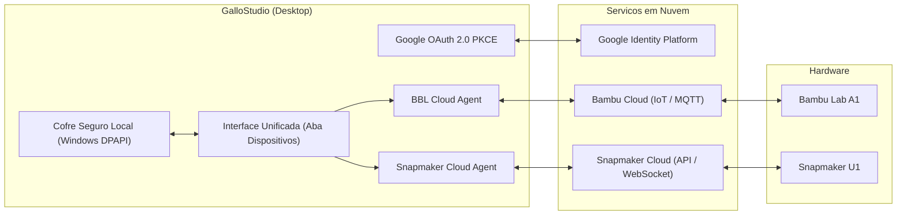

# GalloStudio

GalloStudio e um fatiador 3D avancado de alta precisao, desenvolvido sobre C++17 e wxWidgets, customizado para unificar o controle, envio e monitoramento remoto em nuvem de impressoras 3D multimarca. O projeto integra, em uma unica interface, a gestao simultanea das impressoras Bambu Lab (como a Bambu Lab A1) e Snapmaker (como a Snapmaker U1), com autenticacao centralizada via Google e cofre local de credenciais.

---

## Visao Geral

O GalloStudio resolve a fragmentacao de ecossistemas fechados de manufatura aditiva. Em vez de alternar entre o Bambu Studio e o OrcaSlicer/Snapmaker Luban, o operador conecta sua conta Google uma unica vez. O aplicativo orquestra a comunicacao segura com as nuvens da Bambu Lab e da Snapmaker em paralelo, permitindo fatiar, enviar arquivos de impressao e acompanhar telemetria e cameras em tempo real na mesma aba de dispositivos.



---

## Stack Tecnologica

- **Linguagem**: C++17 (com extensoes seletivas de C++20).
- **Interface Grafica**: wxWidgets 3.2+ com renderizacao acelerada OpenGL.
- **Sistema de Build**: CMake (3.22+) e MSVC (Visual Studio 2022 / 2026, toolset v143/v145).
- **Paralelizacao e Algoritmos**: Intel oneTBB (Threading Building Blocks), Boost C++ Libraries (1.84+), CGAL, OpenVDB, Eigen, OpenCV, Clipper2, libnest2d, Arachne engine.
- **Seguranca e Criptografia**: Windows Data Protection API (DPAPI via `CryptProtectData` e `CryptUnprotectData`), OpenSSL 3.x, libcurl.
- **Rede e Protocolos**: WebSocket (Boost.Beast), MQTT, mDNS/ZeroConf, HTTP/REST.

---

## Pre-requisitos

Para compilar e executar o projeto no Windows, sao necessarios:

- **Sistema Operacional**: Windows 10 ou 11 (64-bit).
- **Compilador C++**: Microsoft Visual Studio 2022 ou Visual Studio 2026 (Community ou superior) com a carga de trabalho "Desenvolvimento para Desktop com C++".
- **CMake**: Versao 3.22 ou superior instalada e disponivel no PATH do sistema.
- **Perl**: Strawberry Perl 5.32+ instalado (necessario para a compilacao das dependencias OpenSSL do projeto).
- **Git**: Com suporte a Git LFS ativado.
- **Hardware de Impressao**: Acesso as contas cloud ou conexao local das impressoras Bambu Lab (Bambu Cloud / LAN mode) e Snapmaker (Snapmaker Cloud / Wi-Fi).

---

## Configuracao e Variaveis de Ambiente

As configuracoes do usuario e os perfis sao isolados e armazenados automaticamente em diretorio dedicado para nao colidir com outras instalacoes:

- **Diretorio de Dados do Usuario**: `%APPDATA%\GalloStudio\`
- **Arquivo Principal de Configuracao**: `%APPDATA%\GalloStudio\GalloStudio.conf`

| Parametro no Arquivo de Configuracao | Tipo | Obrigatorio | Descricao | Exemplo |
| :--- | :--- | :--- | :--- | :--- |
| `version_check_url` | String | Nao | URL da API do GitHub para verificacao de novas versoes | `https://api.github.com/repos/GalloJr/GalloStudio/releases` |
| `stealth_mode` | Booleano | Nao | Desativa comunicacoes em segundo plano nao solicitadas | `false` |
| `language` | String | Nao | Codigo do idioma da interface grafica | `pt_BR` |
| `preset_bundle_auto_update` | Booleano | Nao | Atualizacao automatica de pacotes de presets | `false` |
| `check_stable_update_only` | Booleano | Nao | Filtrar apenas releases estaveis (ignora pre-releases) | `false` |

> [!NOTE]
> Credenciais de autenticacao e tokens de sessao das nuvens Bambu e Snapmaker nao sao salvos em texto puro no arquivo `.conf`. Eles sao criptografados localmente pelo `GalloVault` utilizando chaves vinculadas a conta de usuario do Windows (DPAPI).

---

## Como Executar

### Executando o aplicativo compilado

Para iniciar o fatiador diretamente:

```cmd
run_gallo_studio.bat
```

Ou execute diretamente o binario compilado em:

```cmd
build\src\Release\GalloStudio.exe
```

### Compilando a partir do codigo-fonte

O projeto conta com scripts automatizados de compilacao que gerenciam a ordem entre dependencias externas e o codigo principal.

1. **Compilacao completa (primeira vez ou apos atualizar dependencias)**:
   Compila todas as 40+ dependencias C++ (`deps/build/`) e em seguida o executavel do fatiador:

   ```cmd
   build_gallo.bat -ds
   ```

2. **Compilacao incremental rapida (dia a dia de desenvolvimento)**:
   Quando as dependencias ja estiverem construidas, compila apenas as alteracoes do fatiador em aproximadamente 1 a 2 minutos:

   ```cmd
   build_gallo.bat -s
   ```

---

## Integracoes Externas

### 1. Google OAuth 2.0 PKCE
- **Finalidade**: Ponto de entrada unico para autenticacao do usuario no fatiador.
- **Fluxo**: Authorization Code Flow com Proof Key for Code Exchange (RFC 7636).
- **Seguranca**: As credenciais resultantes sao protegidas no cofre local `GalloVault` sem depender de banco de dados intermediario.

### 2. Bambu Lab Cloud
- **Protocolos**: HTTPS REST, MQTT sobre TLS e WebRTC (streaming de video).
- **Funcionalidades**: Listagem de impressoras vinculadas, envio de tarefas de impressao em formato `.gcode.3mf`, monitoramento de temperaturas, status do AMS Lite e progresso da Bambu Lab A1.

### 3. Snapmaker Cloud
- **Protocolos**: HTTPS REST e WebSocket seguro.
- **Funcionalidades**: Telemetria em tempo real, status de eixos, temperaturas de bico e mesa, envio de arquivos `.gcode` e controle de impressao da Snapmaker U1.

### 4. GitHub Releases API
- **Endpoint**: `https://api.github.com/repos/GalloJr/GalloStudio/releases`
- **Finalidade**: Verificacao periodica de atualizacoes do software sem dependencia de servidores legados do OrcaSlicer. Se novas releases estiverem publicadas no repositorio, o usuario e notificado com link direto para o instalador.

---

## Logs e Diagnostico

Os arquivos de log e historico de operacoes sao gerados nas seguintes pastas:

- **Pasta de Logs**: `%APPDATA%\GalloStudio\log\`
- **Nome do Arquivo de Log**: `debug_<Data>_<PID>.log.0`
- **Diagnostico de Cofre e Conexoes**: Mensagens com prefixo `[GalloVault]`, `[GalloCloud]` ou `[SnapmakerCloud]` no log identificam eventos de decifragem, autenticacao ou comunicacao com as impressoras.

> [!WARNING]
> Caso necessite compartilhar arquivos de log para analise de bugs, confirme que eventuais informacoes confidenciais de rede local foram omitidas.

---

## Estrutura de Pastas Relevante

```text
gallo-slicer/
├── build/                           # Diretorio de saida dos binarios gerados pelo CMake
│   └── src/Release/GalloStudio.exe  # Executavel principal compilado
├── deps/                            # Dependencias C++ externas gerenciadas via CMake
├── docs/                            # Planos de arquitetura e documentacao tecnica
├── resources/
│   └── profiles/                    # Perfis de impressoras, filamentos e processos
│       ├── BBL.json                 # Configuracoes de fabricantes Bambu Lab
│       ├── Snapmaker.json           # Indice de modelos Snapmaker (incluindo U1)
│       └── Snapmaker/               # Modelos 3D de mesa (.stl), texturas (.svg) e bicos da U1
├── src/
│   ├── libslic3r/                   # Nucleo computacional de fatiamento e geometria
│   │   ├── AppConfig.cpp            # Leitura de configuracoes e endpoints de atualizacao
│   │   └── Print.cpp                # Pipeline principal do fatiamento
│   └── slic3r/                      # Interface grafica e integracao com hardware
│       ├── GUI/                     # Janelas, dialogos wxWidgets e aba de Dispositivos
│       └── Utils/                   # Servicos de nuvem, cofre local e comunicacao
│           ├── CloudProvider.hpp    # Constantes dos provedores (Gallo, BBL, Snapmaker)
│           ├── GalloVault.cpp       # Implementacao do cofre seguro via Windows DPAPI
│           ├── GalloCloudServiceAgent.cpp     # Agente de autenticacao Google
│           ├── SnapmakerCloudServiceAgent.cpp # Agente de integracao Snapmaker Cloud
│           └── NetworkAgentFactory.cpp        # Fabrica que inicializa os agentes em paralelo
├── build_gallo.bat                  # Script de automacao de compilacao no Windows
└── run_gallo_studio.bat             # Atalho de execucao do GalloStudio
```

---

## Documentacao do Codigo

O codigo-fonte em C++ segue padroes de documentacao interna estruturados em cabecalhos (`.hpp`/`.h`) e arquivos de implementacao (`.cpp`), com declaracoes explicitas de interfaces e metodos de integracao.
