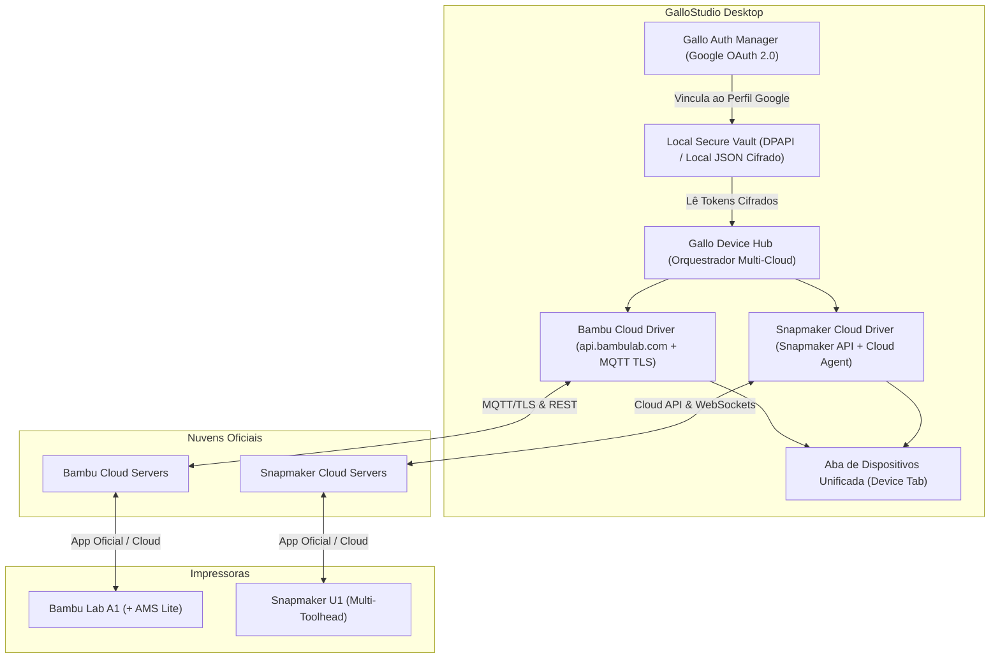
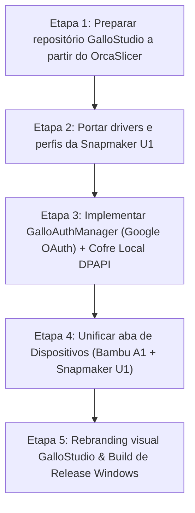

# Plano de Implementação: GalloStudio

## [Goal Description]
Criar o **GalloStudio**, um slicer desktop de alta performance derivado do **OrcaSlicer**, incorporando as inovações de hardware e nuvem do **Snapmaker/OrcaSlicer** (Snapmaker Orca) e a infraestrutura do **BambuStudio**.

O objetivo central é permitir que o usuário:
1. Conecte-se ao software utilizando seu **Login do Google** (Google OAuth 2.0).
2. Armazene localmente de forma segura (sem dependência de banco de dados ou backend de terceiros) as credenciais e sessões de nuvem.
3. Acesse remotamente e gerencie via nuvem na mesma **Aba de Dispositivos (Device Tab)**:
   - **Bambu Lab A1** (via **Bambu Cloud**, com telemetria, AMS Lite, câmera e envio remoto de jobs).
   - **Snapmaker U1** (via **Snapmaker Cloud**, com telemetria das múltiplas toolheads, câmera e envio remoto de jobs).

---

## Arquitetura Geral do GalloStudio



---

## User Review Required

> [!IMPORTANT]
> **Fluxo de Vinculação com o Login do Google e Nuvens dos Fabricantes**:
> As impressoras Bambu Lab e Snapmaker exigem tokens de suas respectivas nuvens (`Bambu Cloud` e `Snapmaker Cloud`) para comunicação remota fora da rede local.
> No **GalloStudio**, a experiência será unificada:
> 1. O usuário entra no GalloStudio com seu **Login do Google**.
> 2. Na primeira vez, vincula suas contas Bambu e Snapmaker na tela de boas-vindas/contas.
> 3. O GalloStudio cifra esses tokens com **Windows DPAPI** (`CryptProtectData`) e associa ao seu Google ID localmente em `%APPDATA%\GalloStudio\user_vault.dat`.
> 4. A partir daí, sempre que o GalloStudio for aberto, ele reconhece o login do Google e conecta automaticamente tanto a **Bambu Lab A1** quanto a **Snapmaker U1** sem exigir logins repetidos.

> [!NOTE]
> **Base de Código Selecionada**:
> - Utilizaremos a árvore principal do **OrcaSlicer** (versão 2.x), aplicando sobre ela os commits e submódulos do **Snapmaker/OrcaSlicer** que contêm os drivers do **Snapmaker U1** e o **Snapmaker Cloud**, mantendo intacto o subsistema Bambu.

---

## Proposed Changes

### 1. Repositório Base e Rebranding (GalloStudio)
Substituição das identidades e nomenclaturas de OrcaSlicer/BambuStudio para GalloStudio:
- Atualização de nome do executável e projeto em `CMakeLists.txt` (`GalloStudio.exe`).
- Substituição de assets gráficos: Splash screen, ícone da janela principal, ícones da barra de ferramentas e logo do menu superior (`resources/images/`, `resources/icons/`).
- Atualização de nomes de pastas de configuração para `%APPDATA%\GalloStudio\`.

---

### 2. Módulo de Autenticação Google e Cofre Local

#### [NEW] `src/slic3r/GUI/GalloAuthManager.hpp` e `.cpp`
Gerencia a autenticação Google via fluxo OAuth 2.0 PKCE (usando navegador padrão do Windows com local loopback HTTP server `http://127.0.0.1:port/callback` ou WebView2):
- Obtenção do perfil básico (Google User ID, Nome, Email, Avatar).
- Manutenção do status de login na barra superior da UI.

```cpp
// Exemplo de interface do GalloAuthManager
class GalloAuthManager {
public:
    static GalloAuthManager& instance();
    bool is_logged_in() const;
    std::string get_user_name() const;
    std::string get_user_email() const;
    void start_google_login(std::function<void(bool success)> callback);
    void logout();
    
    // Gestão do Cofre Local
    bool save_cloud_tokens(const std::string& bambu_token, const std::string& snapmaker_token);
    bool load_cloud_tokens(std::string& out_bambu_token, std::string& out_snapmaker_token);
};
```

#### [NEW] `src/slic3r/GUI/GalloVault.cpp` (Cofre Local Seguro com DPAPI)
Implementa a proteção de dados usando a API nativa do Windows (`CryptProtectData` e `CryptUnprotectData`), garantindo que apenas o usuário logado na máquina consiga decifrar os tokens do Bambu Cloud e Snapmaker Cloud gravados localmente em disco.

---

### 3. Integração do Módulo Snapmaker U1 e Snapmaker Cloud
Portar diretamente do repositório `Snapmaker/OrcaSlicer`:

#### [NEW / PORT] Perfis de Máquina e Filamentos
- `resources/profiles/Snapmaker/Snapmaker U1.json` (presets de bico, toolheads, acelerações e velocidades para a U1).
- Perfis de processos e filamentos recomendados para a U1.

#### [NEW / PORT] `src/slic3r/GUI/Snapmaker/`
- Classes de comunicação do Snapmaker Cloud:
  - `SnapmakerAccountManager.cpp`: autenticação e refresh de token com a API da Snapmaker.
  - `SnapmakerDeviceManager.cpp`: polling/WebSocket de telemetria da U1 (status das toolheads, temperaturas de mesa e bicos, progresso da impressão, câmera).
  - `SnapmakerCloudPrint.cpp`: empacotamento do job e upload para a nuvem da Snapmaker.

---

### 4. Integração do Módulo Bambu Lab A1 e Bambu Cloud
O OrcaSlicer já traz a compatibilidade com a linha Bambu:
- Assegurar o perfil completo da **Bambu Lab A1** e **A1 mini** com AMS Lite ativado (`resources/profiles/BBL/Bambu Lab A1 0.4 nozzle.json`).
- Garantir a conexão de rede via `bambu_networking` com o Bambu Cloud para a A1 (MQTT broker seguro na porta 8883, upload de arquivo fatiado via FTPS/HTTPS para a nuvem).

---

### 5. Aba de Dispositivos Unificada (Device Tab)

#### [MODIFY] `src/slic3r/GUI/DeviceManager.hpp` e `DeviceManager.cpp`
Hoje o DeviceManager do OrcaSlicer assume apenas um tipo de dispositivo ativo por vez. Vamos estendê-lo para um gerenciador de frota:
- Adicionar lista unificada `m_connected_printers` contendo:
  - Item 1: **Bambu Lab A1** (Status: Nuvem Bambu Lab, Status atual, Câmera).
  - Item 2: **Snapmaker U1** (Status: Nuvem Snapmaker, Status atual, Câmera).
- **Barra Superior / Seletor da Aba Dispositivos**:
  - Exibe miniaturas/cards com o status em tempo real de ambas as impressoras simultaneamente.
  - Ao alternar entre a A1 e a U1, a interface da aba renderiza instantaneamente o painel correspondente (painel de telemetria Bambu com AMS Lite ou painel Snapmaker U1 com as toolheads ativas).
- **Envio Automático**:
  - Ao clicar no botão "Print" na barra superior, o GalloStudio identifica automaticamente qual impressora está ativa no projeto (A1 ou U1) e dispara o job para a nuvem correta sem exigir chaveamento manual de contas.

---

## Fases de Execução



1. **Etapa 1: Preparar o Repositório Base**
   - Clonar o OrcaSlicer no diretório `C:\Projects\gallo-slicer`.
   - Renomear os targets e identidades para `GalloStudio`.
2. **Etapa 2: Portar Módulos da Snapmaker U1**
   - Mesclar do branch do `Snapmaker/OrcaSlicer` as pastas de profiles do U1 e os componentes de rede do Snapmaker Cloud.
3. **Etapa 3: Google Login & Cofre Local**
   - Criar `GalloAuthManager` com suporte a Google OAuth 2.0 PKCE.
   - Criar `GalloVault` para salvar as credenciais locais criptografadas via Windows DPAPI.
4. **Etapa 4: Aba de Dispositivos Unificada**
   - Implementar o seletor rápido no topo da aba Device para alternar entre a Bambu A1 e a Snapmaker U1 mantendo ambas conectadas nas nuvens oficiais simultaneamente.
5. **Etapa 5: Validação, Build e Empacotamento**
   - Compilar o executável `GalloStudio.exe` e validar os fluxos com as máquinas.

---

## Verification Plan

### Automated Tests
- Execução dos testes de slicing e serialização do core:
  ```powershell
  cd build
  ctest -C Release --output-on-failure
  ```
- Teste unitário de cifragem/decifragem do cofre local (`GalloVaultTest`):
  - Valida gravação, criptografia via DPAPI e leitura dos tokens.

### Manual Verification
1. **Google Login**:
   - Abrir o GalloStudio -> Clicar em "Login com Google" -> Autenticar na janela do navegador -> Verificar perfil ativo na interface do slicer.
2. **Vinculação de Contas de Nuvem**:
   - Conectar com as credenciais do Bambu Cloud (onde a Bambu A1 está pareada).
   - Conectar com as credenciais do Snapmaker Cloud (onde a Snapmaker U1 está pareada).
   - Fechar o GalloStudio e reabrir: validar que a sessão Google reconecta ambas as nuvens automaticamente a partir do cofre local.
3. **Aba de Dispositivos**:
   - Abrir a aba "Dispositivo" (Device Tab):
     - Selecionar a **Bambu Lab A1**: verificar feed da câmera, temperaturas do bico e mesa aquecida, e status do AMS Lite.
     - Selecionar a **Snapmaker U1**: verificar feed da câmera, status das múltiplas toolheads e temperaturas.
4. **Fatiamento e Envio em Nuvem**:
   - Selecionar o perfil da **Bambu Lab A1**: fatiar um modelo STL e clicar em "Print". Confirmar no app Bambu Handy o início do download e impressão.
   - Selecionar o perfil da **Snapmaker U1**: fatiar um modelo STL e clicar em "Print". Confirmar no Snapmaker App o recebimento do job na U1.
